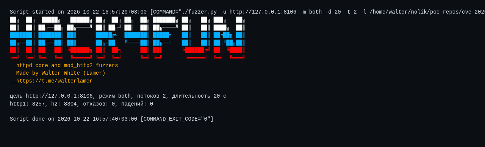

<div align="center">

# 🧪 h2fuzz

**Харнессы для core и mod_http2**

[](https://httpd.apache.org/)
[](https://www.python.org/)
[](https://github.com/wwlamer)
[](https://t.me/walterlamer)

[🐙 GitHub](https://github.com/wwlamer) · [💬 Telegram](https://t.me/walterlamer) · [📚 Документация](docs/DOCUMENTATION.md)

</div>

> 💡 **Коротко:** два чёрных харнесса. Первый мутирует HTTP/1.x запросы: строку запроса, заголовки, Content-Length, chunked. Второй держит валидную h2c-сессию и мутирует HPACK-блоки, CONTINUATION, padding, WINDOW_UPDATE и порядок кадров. Оба считают падения по `AH00051` и `AH00052` в логе MPM.

[📦 Установка](#install) · [🚀 Старт](#start) · [🕹️ Режимы](#modes) · [🧩 Флаги](#flags) · [📊 Результаты](#tested) · [🖼️ Скриншоты](#shots) · [📚 Документация](docs/DOCUMENTATION.md)

<a id="install"></a>
## 📦 Установка

```bash
git clone https://github.com/wwlamer/h2fuzz.git
cd h2fuzz
chmod +x fuzzer.py
./fuzzer.py --help
```

🐍 Только стандартная библиотека Python 3.8+.

<a id="start"></a>
## 🚀 Быстрый запуск

```bash
./fuzzer.py -u http://127.0.0.1:8520 -m both -d 300
./fuzzer.py -u http://127.0.0.1:8520 -m h2 -d 600 -t 4 -l /tmp/httpd/error.log
```

<a id="modes"></a>
## 🕹️ Режимы

| Режим | Что мутирует |
|---|---|
| 🌐 `http1` | строка запроса, склейка заголовков, инъекция `\r\n` и `\x00`, огромные значения, Content-Length на границах, chunked с битым обрамлением |
| ⚡ `h2` | HPACK-блок с длинными строками, разбиение по CONTINUATION, PADDED DATA, PRIORITY, WINDOW_UPDATE на границах, RST и GOAWAY в разных местах |
| 🎛️ `both` | оба режима поровну |

<a id="flags"></a>
## 🧩 Флаги

| Флаг | Значение |
|------|----------|
| `-u, --url` | 🎯 адрес цели, обязателен |
| `-d, --duration` | ⏱️ длительность прогона в секундах |
| `-m, --mode` | 🕹️ `http1`, `h2` или `both` |
| `-t, --threads` | 🧵 число одновременных соединений |
| `-s, --seed` | 🎲 зерно генератора для повторяемости |
| `-l, --log` | 📄 путь к `error_log` для подсчёта падений |
| `-j, --json` | 🤖 машинный вывод |
| `-q, --quiet` | 🔇 без баннера и служебных строк |
| `-p, --plain` | 🎨 без цветов |
| `-V, --version` | 🏷️ версия |
| `-h, --help` | ❓ справка |

<a id="tested"></a>
## 📊 Результаты на 2.4.69

| Прогон | Итераций | Падений |
|---|---|---|
| 🌐 `http1`, 240 с | 25 828 | 0 |
| ⚡ `h2`, случайные кадры, 240 с | 91 015 | 0 |
| ⚡ `h2`, структурные мутации, 300 с | 89 304 | 0 |
| 🎛️ `both`, 20 с, 2 потока | 8 257 + 8 304 | 0 |

😴 Воркер за всё время не перезапускался. Это ограниченный прогон, а не доказательство отсутствия ошибок.

<a id="shots"></a>
## 🖼️ Скриншоты

Реальный прогон на локальном стенде 2.4.69, вывод снят с терминала.



## ⚠️ Ограничения

- 🎯 Мутации без обратной связи по покрытию. Для глубины нужен libFuzzer или AFL++ с in-process харнессом, а не чёрный ящик по TCP.
- 🕵️ ASan не видит ошибки внутри freelist `apr_bucket_alloc`: эта память не приходит из malloc. Единственный надёжный детектор для такого класса это `AH00051` и `AH00052` плюс смена pid воркера, а для отладки сборка APR с `-DAPR_BUCKET_DEBUG`.
- 🔒 TLS и ALPN не покрыты, только h2c.
- 🏠 Значения по умолчанию рассчитаны на локальный стенд.

📚 Подробности о мутациях, сборке ASan-стенда и детекторах: [docs/DOCUMENTATION.md](docs/DOCUMENTATION.md).
